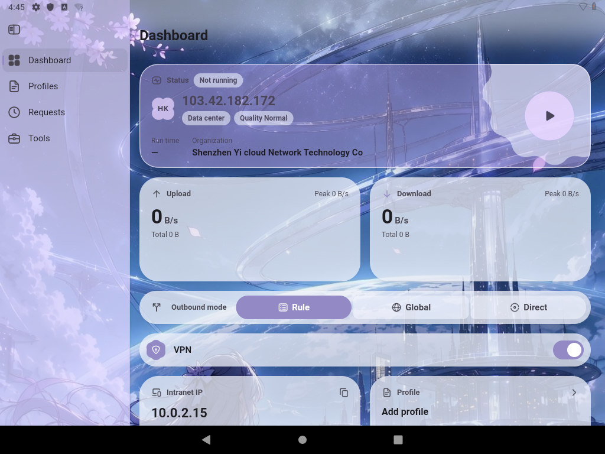
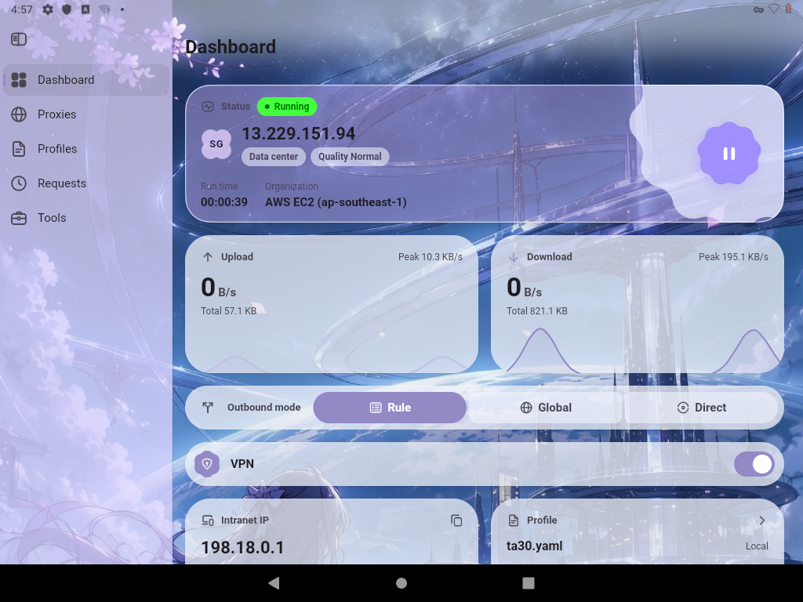
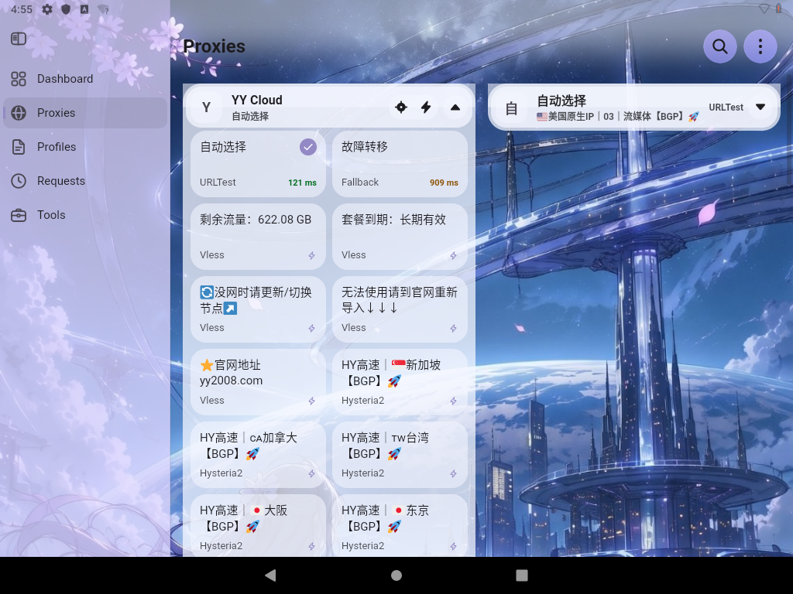
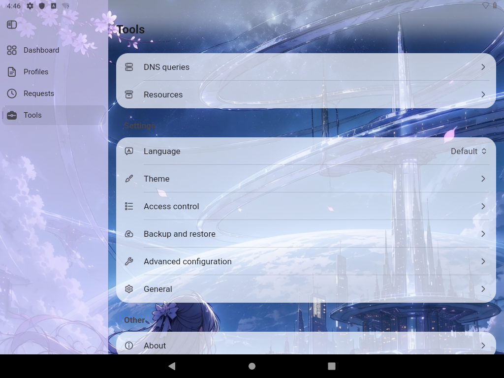

# 星栖 Astryn

> 星光停留的地方

星栖（Astryn）是一款个人网络助手，帮你把网络连接打理好：连哪条线路、走什么规则，都由你说了算。界面干净，安静待在后台，不打扰你。

## 截图

*仪表盘：状态、流量与连接开关，一眼看清。*

*运行中：已连接，状态与流量实时可见。*

*线路分组：多条线路，按组切换。*

*线路详情：展开一组，查看各条线路的状态。*

*工具与设置：语言、主题、备份与更多。*

## 为什么选星栖

- **透明**：代码全部开源，行为看得见，不藏东西。
- **隐私**：零追踪、零广告、零账号。全部在本地，不上传、不留痕。
- **安全**：加密优先。不做中间人，不泄露你的配置和流量。
- **自由**：配置完全自由改。原文可编，规则、DNS、线路组都能自己定，不锁死。

## 下载

到产品页下载最新版：https://astryn.xiaoling.xyz

## 从源码构建

装好 Flutter 环境后，`flutter build apk --release` 即可打出安装包。

## 开源协议

本项目以 GPL-3.0 开源。
